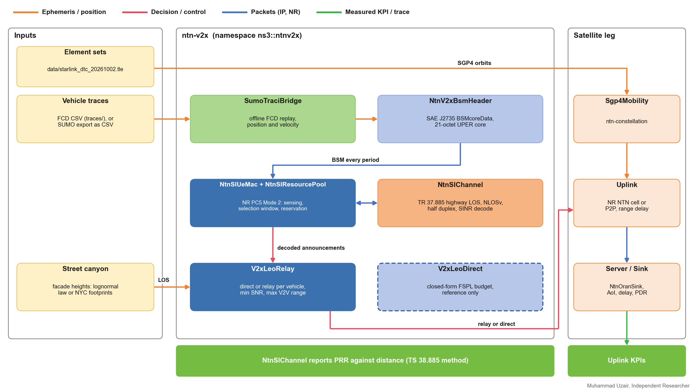
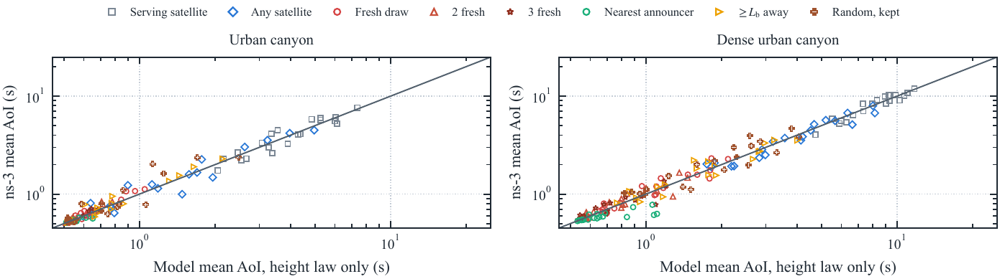
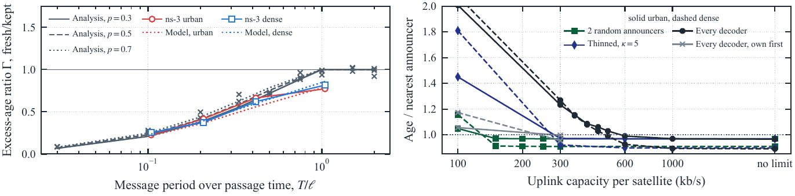

<h1 align="center">ntn-v2x</h1>

<p align="center"><strong>Satellite-assisted V2X: NR sidelink Mode 2, SAE J2735 basic safety messages, and relay decisions that gate real packets</strong></p>

<p align="center">
  <a href="https://www.nsnam.org"></a>
  <a href="https://www.gnu.org/licenses/old-licenses/gpl-2.0.en.html"></a>
  
  
  
</p>

<p align="center">
  <a href="https://github.com/Muhammaduazir69/ns3-ntn-toolkit">Toolkit</a>
  &nbsp;|&nbsp;
  <a href="https://muhammaduazir69.github.io/ns3-ntn-toolkit/modules/ntn-v2x/">Docs</a>
  &nbsp;|&nbsp;
  <a href="INSTALL.md">Install</a>
  &nbsp;|&nbsp;
  <a href="#examples">Examples</a>
  &nbsp;|&nbsp;
  <a href="#results">Results</a>
</p>

---

## Why this module

Vehicles that leave terrestrial coverage are the obvious NTN use case, and an easy one to fake: packet reception ratio against distance can be produced by a threshold without a single packet. Here the sidelink carries real messages. Basic safety messages are encoded the way SAE J2735 encodes them, a 21-octet core with UPER offset-from-lower-bound integers and the standard's range clamps. That matters more than it sounds: DE_Elevation spans -4096 to 61439, wider than a signed 16-bit integer, so a naive cast turns a legal 6000 m altitude into -553.6 m.

Relay decisions actuate. A runtime transmit gate lets a decision start and stop a flow mid-run, which ns-3 application start and stop times cannot, so a direct-versus-relay policy shows up as real traffic from terminals on air against exactly zero from gated ones. Re-measured on 2026-09-01 on the default run: 14 792 packets on air, 0 gated (an earlier count of 28 892 stopped reproducing when the spine's default carrier and width moved to 2.185 GHz and 20 MHz; the zero is what the claim rests on). Vehicles are real UEs carrying their own PHY measurements, so blockage varies per vehicle rather than by loop parity.

## System design

<p align="center">
  
</p>

<p align="center"><em>Figure 1. Classes of ntn-v2x. Vehicle traces drive <code>SumoTraciBridge</code>; each vehicle broadcasts a J2735 BSM over the NR Mode-2 sidelink; decoded announcements feed the relay decision, which gates the vehicle's uplink to SGP4 satellites (an NR NTN cell or a point-to-point path whose delay follows the slant range). <code>V2xLeoDirect</code> is kept only as a closed-form reference. Source: <code>doc/figures/make_architecture.py</code>.</em></p>

| Header | Provides |
|---|---|
| `model/sumo-traci-bridge.h` | `SumoTraciBridge`: offline replay of floating-car data (`LoadFcdTrace(csv)`, columns `time,vehid,x,y,z,speed`). Applies position and velocity, so `GetVelocity()` and the BSM speed and heading fields are real; register a `ConstantVelocityMobilityModel`, since a constant-position model cannot hold a velocity (dropped samples are counted by `VelocitySamplesDropped()`). Tracks sync jitter and exports per-vehicle samples through a `TracedCallback`. |
| `model/ntn-nr-sidelink.h` | NR PC5 sidelink Mode 2 (TS 38.321 Section 5.22). `NtnSlResourcePool` (subchannels x slots, TS 38.331 SL-ResourcePool); `NtnSlUeMac` (sensing-based autonomous selection: candidates in the T1..T2 window, exclusion above an SL-RSRP threshold, the 20 percent rule with 3 dB steps, periodic reservation with a reselection counter); `NtnSlChannel` (TR 37.885 highway LOS path loss with log-normal shadowing and NLOSv blockage, half duplex, SINR decode against thermal noise plus noise figure with co-channel interference summed in linear power, TS 38.885 PRR through `GetPrr` and `GetPrrWithinRange`). |
| `model/ntn-v2x-bsm-header.h` | `NtnV2xBsmHeader`: SAE J2735 (2016) BSMcoreData as an ns-3 `Header`, 21 octets on the wire (1 + 4 + 2 + 4 + 4 + 2 + 2 + 2), fields in J2735 resolutions; `SetFromState()` fills it from SI quantities. |
| `model/v2x-leo-relay.h` | `V2xLeoRelay`: per-vehicle direct or relay assignment with `m_minDirectSnrDb` and `m_maxV2vRangeM`; `EvaluateAll()` returns the decisions. |
| `model/v2x-leo-direct.h` | `V2xLeoDirect`: closed-form vehicle to LEO budget (free-space loss, SNR, elevation), kept as a comparison baseline; the examples decide on measured SINR. |
| `model/maritime-scenario.h` | `MaritimeMobilityModel`: deprecated, offline tests only. The maritime path is `ntn-v2x-maritime-ais`, which replays recorded AIS tracks through `ntn-sagin`. |
| `helper/ntn-v2x-helper.h` | `WriteDeterministicTestFcdCsv`: a disclosed, RNG-free FCD trace for the test suite. |

## Results

The figures and numbers below come from a street-canyon relaying study built on `examples/ntn-v2x-canyon-relay.cc` and this module's Mode-2 sidelink (`paper/tits-2026-sidelink-relay/`: code and data; main campaign `run_ns3_canyon5.py`, outputs `out/ns3_canyon5.jsonl`, numbers by `make_macros5.py`). Setup: the 638 Starlink satellites that CelesTrak labels direct-to-cell (43 and 53 deg inclination, near 350 km), propagated with SGP4 from element sets of 2 October 2026; a straight street in Manhattan whose facade heights are drawn once per run; line of sight to each satellite decided every 100 ms by the exact ray geometry against the facades; SUMO stop-and-go traffic on a 1.2 km ring (two lanes per direction, a signal every 240 m); one status report per vehicle per second; an assumed shared uplink of 300 kb/s per satellite. Each rule ran at 20 start times per canyon (10 in the suburban case), each start with its own facade draw, signal offsets, vehicle placement and satellite pass.

<p align="center">
  
</p>

<p align="center"><em>Figure 2. Mean age of information at the server, analytical model against ns-3, one marker per start, for eight baseline forwarding rules in the urban and the dense canyon. The model takes the facade-height law, the geometry, the SUMO trajectories and each run's measured mean delay.</em></p>

<p align="center">
  
</p>

<p align="center"><em>Figure 3. Left: excess-age ratio of a fresh relay draw to a kept relay against the message period over the passage time, analysis, Monte Carlo and ns-3. Right: age as a median paired ratio to the nearest announcing neighbor at the same uplink budget against the uplink capacity per satellite, ten second-half starts (solid urban, dashed dense).</em></p>

| Measured in ns-3 (median over 20 starts) | Urban canyon | Dense canyon |
|---|---|---|
| Age of information, serving satellite only | 4.08 s | 8.42 s |
| Age of information, any satellite in line of sight | 1.19 s | 3.63 s |
| Age of information, nearest neighbor that announced an uplink | 0.53 s | 0.58 s |
| Distance driven since the server's newest report: any satellite / nearest announcer | 7.8 m / 3.3 m | 24.3 m / 3.6 m |
| Uplink forwards per blocked message, two random announcers | 1.9 | 1.8 |
| Uplink forwards per blocked message, thinned every-decoder forwarding | 4.9 | 4.5 |
| Model error on the age above its floor, eight baseline rules (median) | 23 % | 20 % |

The one-bit uplink announcement carried in each broadcast is what makes a single named relay work. Among forwarding rules the differences were smaller and lay mostly in uplink cost. Forwarding is at the application layer, and visibility rests on building geometry rather than a measured satellite channel.

## Quick start

Inside the toolkit, where the module is already present and built:

```bash
./ns3 run "ntn-v2x-pc5-sidelink-bsm --numVehicles=20 --duration=4"
./ns3 run "ntn-v2x-canyon-relay --policy=relay --simSeconds=60"
./test.py -s ntn-v2x
```

Standalone, into an existing ns-3.43 tree:

```bash
git clone -b ntn-v2x-v2 https://github.com/Muhammaduazir69/ntn-v2x.git contrib/ntn-v2x
./ns3 configure --enable-examples --enable-tests
./ns3 build
```

`INSTALL.md` lists the dependencies. Most examples build on `ntn-traffic` (the real NR stack) and `ntn-constellation` (orbits), so the toolkit tree is the easiest place to run them.

## Examples

Binaries land at `build/contrib/ntn-v2x/examples/ns3.43-<name>-default`.

| Example | What it shows | Command |
|---|---|---|
| `ntn-v2x-canyon-relay` | Vehicles in a street canyon report status to a server through LEO satellites; a blocked vehicle names a neighbor in its Mode-2 broadcast and the neighbor forwards over its own uplink. Policies `direct`, `multisat`, `relay`, `blind`, `blindfar`, `random`, `rand2`, `rand3`, `roundrobin`, `anyfwd`, `anyp` and more; shared per-satellite uplink via `--ulKbps`. | `./ns3 run "ntn-v2x-canyon-relay --policy=relay --simSeconds=60"` |
| `ntn-v2x-pc5-sidelink-bsm` | Highway vehicles broadcast J2735 BSMs directly over PC5 with Mode-2 selection, no gNB; PRR by distance bucket. | `./ns3 run "ntn-v2x-pc5-sidelink-bsm --numVehicles=20 --numSubchannels=5 --duration=4"` |
| `ntn-v2x-edge-urllc` | A two-vehicle platoon on a real NR LEO cell with a URLLC control slice and an eMBB sensor slice; a hazard xApp consumes measured KPM features every 100 ms with inference on the satellite or on the ground, and the decision latency is the outcome. | `./ns3 run "ntn-v2x-edge-urllc --edge=sat"` |
| `ntn-v2x-real-stack` | Every vehicle a UE on a real NR NTN cell; the direct-or-relay decision rides the measured per-UE SINR minus blockage, with the closed-form value printed beside it. | `./ns3 run "ntn-v2x-real-stack --duration=20 --numVehicles=8"` |
| `ntn-v2x-rural-highway` | A LEO pass over a rural highway with vehicles replayed from an FCD trace; direct, relay and orphan counts each second from a measured baseline SINR. | `./ns3 run "ntn-v2x-rural-highway --vehicles=40 --simTime=30"` |
| `ntn-v2x-leo-relay-traffic` | A two-hop data plane, shadowed vehicle to peer vehicle to LEO to server, with real IPv4 forwarding and contact-gated hops; BSM delay, jitter and loss measured at `NtnOranSink`. | `./ns3 run "ntn-v2x-leo-relay-traffic --simSeconds=60 --bsmHz=10"` |
| `ntn-v2x-maritime-ais` | A vessel replayed from a recorded Danish Maritime Authority AIS track (via `ntn-sagin`) as a UE of a real NR NTN cell. | `./ns3 run "ntn-v2x-maritime-ais --simSeconds=30"` |

## Tests

```bash
./test.py -s ntn-v2x
```

`test/ntn-v2x-test-suite.cc` registers 11 test cases: FCD replay jitter, SUMO speed reaching the mobility model, the TR 37.885 sidelink physics, the free-space budget of `V2xLeoDirect`, relay fallback below the SNR threshold, bounded maritime motion, a 100-vehicle replay inside the test budget, the J2735 BSM header round trip, Mode-2 selection with the half-duplex rule and pool-size dependence of PRR, a BSM carried over the sidelink, and a sidelink delay that is real rather than zero.

## Dependencies

- ns-3.43 `core`, `mobility`, `network` (linked by `CMakeLists.txt`).
- Examples: `ntn-traffic` (`NtnRealStackHelper`, `NtnOranApplication`), `ntn-constellation` (SGP4), `ntn-cho` (TR 38.811 terminals), `ntn-sagin` (AIS replay), `oran-ntn` (xApp in the URLLC example), the toolkit's `mmwave`.
- Data: `data/starlink_dtc_20261002.tle` (public CelesTrak), `traces/*.csv` (synthetic constant-speed FCD fixtures).

## Scope and limitations

- **Offline replay only.** `ConnectTcp()` opens a socket and closes it; the TraCI stepping protocol is not implemented, so live SUMO co-simulation is not available. Convert SUMO fcd-export to the CSV dialect.
- **MAC abstraction.** The sidelink models resource pools, sensing, reservation, half duplex, collisions and an SINR decode. It does not decode PSCCH/PSSCH bits, combine HARQ or model second-stage SCI formats.
- **Read PRR against distance with care.** At 23 dBm and 5.9 GHz the TR 37.885 highway model closes a link to roughly 9.6 km, about twenty times the platoon's span, so the shipped highway scenario is not range limited. Measured PRR within 50 m was 1.000 at 10 vehicles and 0.997 at 30 and at 60; the residual loss comes from half duplex and same-subchannel collisions. A curve that falls off within a few hundred meters needs TR 37.885 densities and offered load.
- The shipped FCD traces are synthetic fixtures, not SUMO microsimulations; the canyon study used SUMO 1.18 traces generated by its own `make_traces.py`.

## Standards

3GPP TS 38.321 Section 5.22 and TS 38.331 (sidelink Mode 2, SL-ResourcePool), TS 38.885 and TR 37.885 (V2X evaluation methodology, PRR, highway and urban channels), TS 23.287 (V2X architecture), SAE J2735 (BSM, UPER encoding), TR 38.811 and TR 38.821 for the satellite leg.

## Citation

If you use this module, please cite the toolkit article:

```bibtex
@article{uzair2026ns3ntn,
  author  = {Uzair, Muhammad and others},
  title   = {ns3-ntn-toolkit: An Integrated ns-3 Platform for {6G} Non-Terrestrial Networks},
  journal = {IEEE Open Journal of the Communications Society},
  year    = {2026},
  doi     = {10.1109/OJCOMS.2026.3745010}
}
```

## License

GPL-2.0-only, matching ns-3. See [LICENSE](LICENSE). Element sets are public CelesTrak data.

## Contact

**Muhammad Uzair**, Independent Researcher
muhammaduzairr69@gmail.com · [ORCID 0009-0002-4104-2680](https://orcid.org/0009-0002-4104-2680)

Part of the [ns3-ntn-toolkit](https://github.com/Muhammaduazir69/ns3-ntn-toolkit), an integrated ns-3.43 platform for 6G non-terrestrial network research. Mirrored on [GitLab](https://gitlab.com/ns3-ntn-toolkit).
